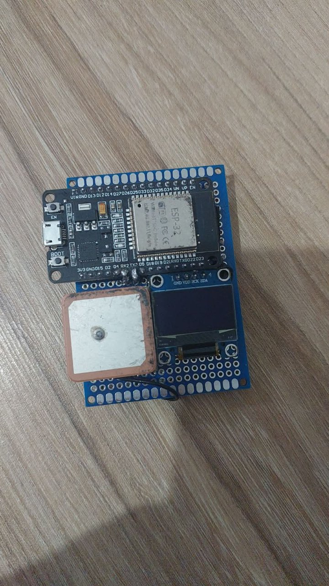
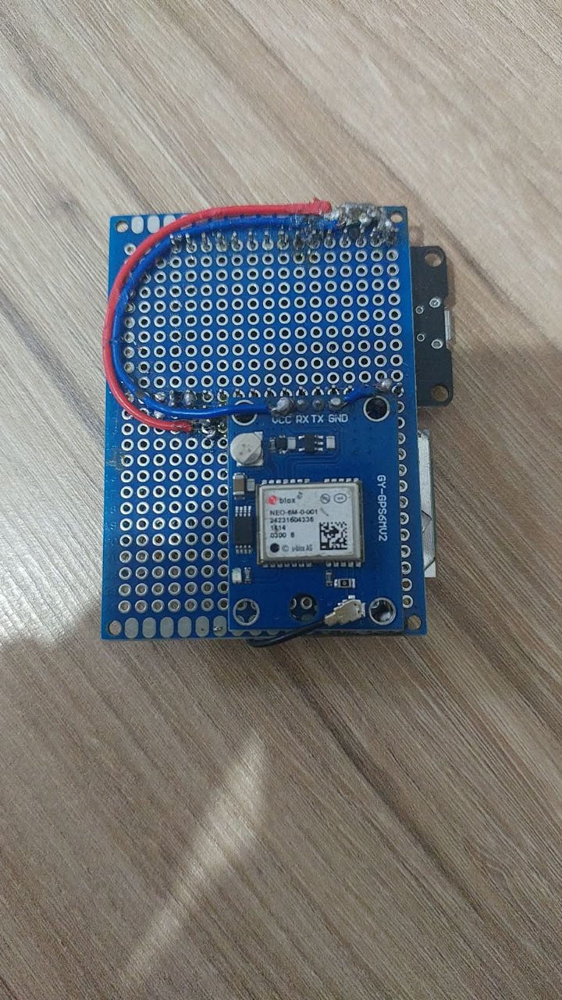
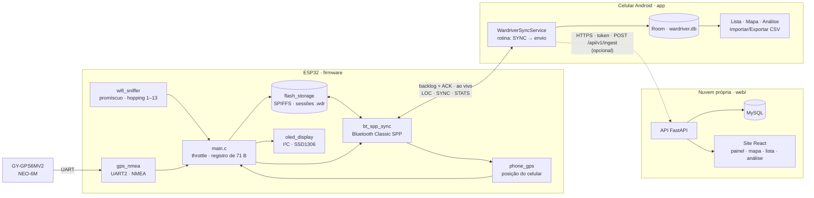
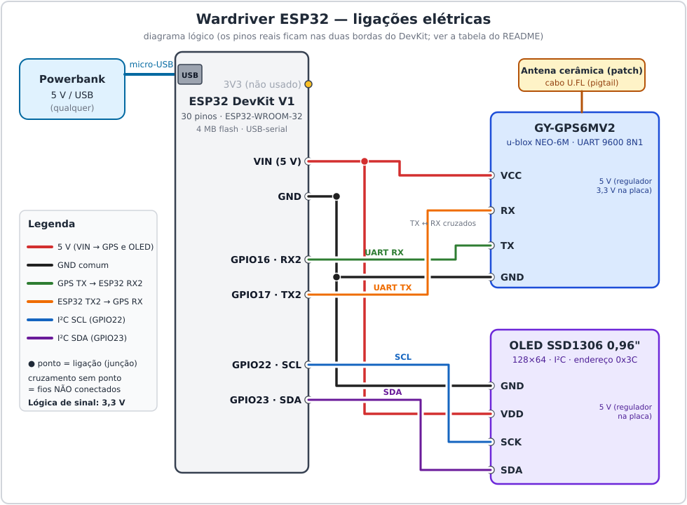

# Wardriver — Wi-Fi portátil com ESP32

Dispositivo de *wardriving* de baixo custo: um **ESP32** escuta, de forma **100% passiva**, os anúncios públicos
de redes Wi-Fi (beacons e probe responses 802.11), associa cada rede à **posição GPS** e guarda tudo na memória
interna. Um **aplicativo Android** sincroniza os dados por **Bluetooth**, mostra as redes em lista e mapa,
importa/exporta CSV e ainda fornece a posição do celular ao dispositivo. Opcionalmente, o app envia as redes a uma
**nuvem própria** (backend Python + MySQL, painel em React) em intervalos regulares durante a coleta: veja
[6. Wardriver Web](#6-wardriver-web-nuvem-opcional).

<p align="center">
  
  &nbsp;&nbsp;
  
</p>
<p align="center"><em>O protótipo montado numa placa perfurada de 5 × 7 cm. Esquerda: face superior (DevKit ESP32, OLED e antena
cerâmica do GPS). Direita: face inferior (módulo GPS GY-GPS6MV2 e a fiação).</em></p>

---

## Sumário

1. [Visão geral](#1-visão-geral)
2. [Uso responsável e privacidade](#2-uso-responsável-e-privacidade)
3. [Hardware](#3-hardware)
4. [Firmware (ESP32)](#4-firmware-esp32)
5. [Aplicativo Android](#5-aplicativo-android)
6. [Wardriver Web (nuvem, opcional)](#6-wardriver-web-nuvem-opcional)
7. [Estrutura do repositório](#7-estrutura-do-repositório)
8. [Solução de problemas](#8-solução-de-problemas)
9. [Limitações conhecidas](#9-limitações-conhecidas)
10. [Desenvolvimento e testes](#10-desenvolvimento-e-testes)
11. [Autoria e licença](#11-autoria-e-licença)

---

## 1. Visão geral

### O que o dispositivo faz

- Coloca o rádio Wi-Fi do ESP32 em **modo promíscuo** e percorre continuamente os **canais 1 a 13** (*channel hopping*:
  110 ms em cada canal, 200 ms em 1/6/11, uma volta a cada ~1,7 s). Processa apenas quadros de gerenciamento
  **beacon** e **probe response**: BSSID, SSID, canal, RSSI, tipo de criptografia (aberta/WEP/WPA/WPA2/WPA3) e dados de
  WPS. Também lê *association/reassociation requests*, **só para descobrir o nome** de um AP (ver 4.5).
- **Não** se associa a redes, **não** envia *deauth*, **não** captura *handshakes* nem tráfego de dados e **não**
  grava endereços de clientes nem *probe requests*. Nos *association requests* o MAC do cliente é **zerado dentro do
  callback do rádio**, antes de qualquer processamento. Só dados que qualquer ponto de acesso já transmite em público.
- Combina cada captura com a melhor posição disponível: a do **módulo GPS** (GY-GPS6MV2) ou a do **celular**
  (via Bluetooth), a que tiver menor erro estimado.
- Grava registros binários de 71 bytes na **memória interna** (SPIFFS, ~2,4 MB) e mostra o estado num **display OLED**.
- Quando o celular conecta, o app baixa os registros (com verificação CRC32), confirma cada arquivo e só então o
  ESP32 o apaga. Os dados ficam no celular, em lista, mapa e CSV. Com a **rotina automática** ligada, o app repete isso
  a cada N minutos durante a coleta e, em seguida, pode enviar as redes à nuvem (ver 5.5).

### Como as peças se falam



### Fonte da posição (módulo GPS × celular)

As **duas fontes ficam ativas o tempo todo**. Para cada captura vence a de **menor erro estimado**: o celular usa a
precisão que o Android informa (em metros); o módulo usa `HDOP × 5 m`. Há histerese de 30% (só troca de fonte
quando a outra é claramente melhor) e o empate favorece o celular. O fix do módulo só vale se foi atualizado nos
últimos 3 s, e sem nenhuma fonte válida o registro sai **sem posição**. A fonte aparece no OLED (`GPS:CEL` /
`GPS:MOD` / `GPS:--`) e no registro (`gps_quality` ≥ 1 = módulo; 0 com fix = celular).

---

## 2. Uso responsável e privacidade

- **Dados coletados são sensíveis.** SSID + BSSID + posição descrevem onde redes de terceiros estão, e o nome de uma
  rede doméstica pode identificar uma pessoa. No Brasil isso pode ser **tratamento de dados pessoais** (LGPD), mesmo
  que a fonte seja pública, e pesquisa acadêmica com esses dados pode exigir avaliação de comitê de ética (CEP/CONEP).
- Este repositório **não contém dados coletados** e o `.gitignore` bloqueia `*.wdr`, `*.db`, exportações `*.csv`
  e `firmware_stats.log`. **Não publique** capturas suas nem de outras pessoas.
- O dispositivo é **passivo**, mas a legislação e as regras de cada local variam. Use apenas onde for permitido e
  não use o projeto para atacar, acessar ou perturbar redes.
- O app declara `android:allowBackup="true"`: o banco de redes pode entrar no *backup* automático do Android.
  Se isso for indesejado, mude para `false` em `android-app/app/src/main/AndroidManifest.xml`. A configuração da nuvem
  (endereço, token cifrado, marca d'água) é **excluída** do backup e da transferência entre aparelhos.
- **Envio à nuvem é opcional e desligado por padrão.** Ao ligar, o app mostra (uma vez) exatamente o que sai do aparelho
  (SSID, BSSID, canal, sinal, criptografia e posição de cada rede) e para onde, e pede confirmação. A nuvem guarda dados
  pessoais em potencial. O site da nuvem é aberto a quem aceitar um termo de compromisso, **sem senha**: decida o prazo
  de retenção e use HTTPS. Ver [6. Wardriver Web](#6-wardriver-web-nuvem-opcional).
- O firmware descarta o MAC do cliente dos *association requests* na origem; nenhum endereço de cliente é gravado,
  enviado ao celular ou à nuvem.
- O pareamento Bluetooth usa um **PIN fixo (`1234`)**, conveniente para um protótipo mas fraco. Troque-o em
  `firmware/components/bt_spp_sync/bt_spp_sync.c` (evento `ESP_BT_GAP_PIN_REQ_EVT`) se o dispositivo for usado fora de bancada.

---

## 3. Hardware

### 3.1 Lista de materiais

| # | Item | Especificação usada no protótipo | Observação |
|--:|------|----------------------------------|------------|
| 1 | Placa de desenvolvimento | **ESP32 DevKit V1, 30 pinos** (ESP32-WROOM-32, chip ESP32-D0WD-V3, **4 MB de flash**), micro-USB | Conversor USB-serial na placa (CH9102 na unidade usada). **Precisa ser WROOM**, não WROVER: no WROVER, GPIO16/17 são da PSRAM. |
| 2 | Módulo GPS | **GY-GPS6MV2** (u-blox **NEO-6M**-0-001) com regulador de 3,3 V | Cabeçalho `VCC RX TX GND`. UART 9600 8N1. |
| 3 | Antena do GPS | Antena cerâmica (*patch*) com cabo **U.FL** (pigtail) | Encaixe U.FL frágil: confira se está bem assentado. |
| 4 | Display | **OLED 0,96″ SSD1306**, 128 × 64, I²C, 4 pinos (`GND VDD SCK SDA`) | Endereço `0x3C`. Módulo com regulador na placa. |
| 5 | Placa de montagem | Placa de prototipagem **perfurada, dupla face**, passo 2,54 mm, ~**5 × 7 cm** | Ver [3.5](#35-a-placa-e-a-montagem). |
| 6 | Fios e solda | Fio rígido isolado (24–26 AWG), solda, barras de pinos | |
| 7 | Alimentação | Cabo micro-USB + **powerbank** 5 V (qualquer) | Consumo baixo (dezenas de mA) — ver [3.6](#36-alimentação-e-cuidados-elétricos). |
| 8 | Celular | Android 8.0+ (API 26) com Bluetooth Classic | Testado num Samsung com Android 16. **Bluetooth Classic (SPP) só funciona em Android**; iOS não expõe SPP. |

Ferramentas: ferro de solda, multímetro (recomendado), computador com ESP-IDF e cabo USB de dados.

### 3.2 Pinagem

| Módulo | Sinal do módulo | Pino do ESP32 | Direção | Observações |
|--------|-----------------|---------------|---------|-------------|
| GPS | `TX` | **GPIO16** (`RX2`, UART2) | GPS → ESP32 | Cruzado: TX de um vai no RX do outro. |
| GPS | `RX` | **GPIO17** (`TX2`, UART2) | ESP32 → GPS | Reservado para configuração UBX futura; o firmware atual só lê. |
| GPS | `VCC` | **VIN** (5 V) | — | O módulo tem regulador de 3,3 V e aceita 3,3–5 V. |
| GPS | `GND` | GND | — | |
| OLED | `SCK` (SCL) | **GPIO22** | ESP32 → OLED | I²C, 400 kHz. |
| OLED | `SDA` | **GPIO23** | bidirecional | Pinos I²C **não padrão** (o padrão do ESP32 seria 21/22). |
| OLED | `VDD` | **VIN** (5 V) | — | Regulador de 3,3 V na placa do módulo (confira, ver 3.6). |
| OLED | `GND` | GND | — | |
| — | 3V3 | *não usado* | — | |

Todos os valores são opções do `menuconfig` (menu **Wardriver Configuration**) e estão repetidos em
`firmware/sdkconfig.defaults`. Se sua fiação for diferente, ajuste lá em vez de editar o código.

Por que esses pinos: GPIO16/17 são a UART2 livre do WROOM-32; GPIO22/23 são livres e **não** são pinos de
*strapping* (0, 2, 5, 12, 15), então o OLED e o GPS **não atrapalham o boot nem a gravação**. Evite GPIO34–39
(somente entrada) e GPIO6–11 (flash).

### 3.3 Diagrama de ligações

<p align="center">
  
</p>

Versão em texto, para conferir com o multímetro:

```
 Powerbank 5V ──micro-USB──► ESP32 DevKit V1
                                │
   VIN (5V) ────────────┬───────┴──► GPS  VCC
                        └──────────► OLED VDD
   GND      ────────────┬──────────► GPS  GND
                        └──────────► OLED GND
   GPIO16 (RX2) ◄─────────────────── GPS  TX      ┐ UART2, 9600 8N1
   GPIO17 (TX2) ─────────────────►   GPS  RX      ┘ (TX ↔ RX cruzados)
   GPIO22 ──────────────────────────► OLED SCK    ┐ I²C, 400 kHz,
   GPIO23 ◄────────────────────────► OLED SDA     ┘ endereço 0x3C
   GPS  ══ cabo U.FL ══ antena cerâmica (patch)
```

### 3.4 Fotos do protótipo

| Face superior | Face inferior |
|:-------------:|:-------------:|
|  |  |
| DevKit ESP32 (micro-USB à esquerda), OLED e antena cerâmica do GPS. | Módulo GPS GY-GPS6MV2 (cabeçalho `VCC RX TX GND` no alto do módulo) e a fiação de fios isolados. |

### 3.5 A placa e a montagem

O protótipo usa uma **placa de prototipagem perfurada dupla face** (furos metalizados, passo de 2,54 mm), com
cerca de 5 × 7 cm, em vez de uma PCB fabricada. Não há esquemático de PCB nem arquivos de fabricação neste
repositório: a "PCB" é essa placa universal com as ligações feitas à mão, conforme o diagrama acima.

Disposição usada (ver fotos):

- **Face superior:** DevKit ESP32 (micro-USB para fora da borda da placa, para alcançar o cabo), OLED logo abaixo da
  fileira de pinos do DevKit e a antena cerâmica do GPS.
- **Face inferior:** módulo GPS GY-GPS6MV2, com o pigtail U.FL levando o sinal até a antena na face superior.
- Os pinos `SCK` e `SDA` do OLED ficam na mesma coluna dos pinos `D22` e `D23` do DevKit (ver a foto), o que
  encurta as ligações de I²C. `GND` e `VDD` do OLED vão para as trilhas de GND e 5 V.

Passo a passo sugerido:

1. **Teste os módulos antes de soldar**, um a um, com fios de bancada (ver [3.7](#37-teste-de-bancada)).
2. Solde as barras de pinos e posicione DevKit, OLED e GPS na placa. Se quiser poder trocar o DevKit, use
   **soquetes fêmea** em vez de soldá-lo direto.
3. Faça as **trilhas de alimentação**: uma para 5 V (do pino `VIN`) e uma para GND, alimentando GPS e OLED.
4. Ligue os sinais: UART (cruzada) e I²C, conforme a tabela.
5. **Confira com o multímetro** antes de ligar: continuidade de cada sinal, **ausência de curto entre 5 V e GND** e
   entre 5 V e qualquer pino de sinal.
6. Prenda o cabo U.FL sem dobrá-lo em ângulo fechado e posicione a antena com **visão livre do céu**
   (a face da antena para cima, longe de metal e da bateria).

### 3.6 Alimentação e cuidados elétricos

- **Alimentação:** pelo micro-USB do DevKit, a partir de um powerbank ou do computador. O pino `VIN` do DevKit
  entrega o 5 V que chega do USB e alimenta GPS e OLED. O consumo total é baixo (o ESP32 com Wi-Fi + Bluetooth
  domina).
- **Níveis lógicos:** os sinais do ESP32, do NEO-6M e do SSD1306 são de **3,3 V**. Os módulos aceitam 5 V na
  alimentação porque têm regulador na placa, mas **confirme no seu módulo OLED**: alguns 0,96″ não têm regulador e
  devem ir em 3V3. Com o multímetro, meça `SDA`/`SCL` em repouso, com tudo ligado: devem ficar em ~3,3 V. Se
  aparecer ~5 V, **desligue e ligue o OLED no 3V3**, pois os GPIO do ESP32 não toleram 5 V.
- **Oscilação de tensão em powerbank:** uma queda momentânea no 5 V pode resetar **só o OLED** (o ESP32 segue
  funcionando). O firmware trata isso reenviando a configuração do painel a cada quadro (a tela reacende em ~2 s).
  Se ainda houver quedas, um **capacitor eletrolítico de 100–470 µF** entre 5 V e GND, junto ao módulo, é uma
  melhoria comum. *Não faz parte do protótipo original e não foi testado neste projeto.*
- **Strapping:** não use GPIO0, 2, 5, 12 ou 15 para novos periféricos sem checar o efeito no boot.

### 3.7 Teste de bancada

Antes do firmware completo, valide cada bloco:

1. **DevKit:** conecte por USB, grave o firmware ([4.2](#42-compilar-e-gravar)) e abra o monitor serial. Deve
   aparecer o log de boot abaixo.
2. **OLED:** o painel mostra `WARDRIVER`, `REDES: n`, `GPS: …` e `MEM: …`. Tela apagada: ver [8](#8-solução-de-problemas).
3. **GPS:** com a antena ao ar livre, o log passa a mostrar `mod_view`/`mod_trk` (satélites vistos/rastreados) e,
   com fix, `mod_fix=1` e a mensagem `GPS do modulo: FIX obtido pela 1a vez apos N s de boot`. O primeiro fix a frio
   do NEO-6M pode levar **vários minutos**, e dentro de casa pode nunca ocorrer.
4. **Bluetooth:** o log mostra `servidor SPP no ar como "WARDRIVER"`.

Log de boot esperado (resumido):

```
I wardriver: wardriver iniciando...
I wardriver: motivo do ultimo reset: POWERON (energia religada)
I flash_storage: SPIFFS montado em /spiffs: 2/2287 KB usados
I flash_storage: sessao iniciada: /spiffs/sess_0001.wdr
I bt_spp_sync: servidor SPP no ar como "WARDRIVER", aguardando conexao...
I wifi_sniffer: captura iniciada no canal 6 (fixo)
I wardriver: captura ativa — sessao=sess_0001 canal=6 storage=memoria interna
I wardriver: redes=3 fonte=nenhuma mod_fix=0 mod_sats=0 mod_view=0 mod_trk=0 mod_snr=-1 lat=0.000000 lon=0.000000 mem=0% heap_livre=76308
```

---

## 4. Firmware (ESP32)

### 4.1 Pré-requisitos

- **ESP-IDF 5.5.x** (desenvolvido e testado com a **5.5.3**), alvo `esp32`. Siga o
  [guia de instalação da Espressif](https://docs.espressif.com/projects/esp-idf/en/stable/esp32/get-started/index.html).
- No Linux, seu usuário precisa estar no grupo `dialout` para acessar a porta serial
  (`sudo usermod -aG dialout $USER`, depois faça logout/login).
- Cabo USB **de dados** (alguns cabos só carregam).

### 4.2 Compilar e gravar

```bash
cd firmware
. ~/esp/esp-idf/export.sh            # ajuste para o caminho do seu ESP-IDF
idf.py set-target esp32              # cria o sdkconfig a partir de sdkconfig.defaults
idf.py build
idf.py -p /dev/ttyACM0 flash monitor # porta típica: /dev/ttyACM0 (CH9102) ou /dev/ttyUSB0 (CP210x/CH340)
```

Sair do monitor: `Ctrl+]`. O `sdkconfig` completo **não é versionado**: ele é gerado a partir de
`firmware/sdkconfig.defaults` (Bluetooth Classic + SPP, flash de 4 MB, tabela de partições customizada, pinos).

> **Aviso ao trocar de ambiente/IDE:** se você compilar o mesmo `build/` com outra instalação do ESP-IDF ou outro
> Python, o `idf.py` recusa com *"…is currently active in the environment while the project was configured
> with…"*. Rode `idf.py fullclean` e compile de novo.

O Wi-Fi promíscuo e o Bluetooth Classic **não são compatíveis com um alvo diferente do ESP32 clássico** (o ESP32-S3/C3
não têm Bluetooth Classic). Ao usar outra placa, será preciso reescrever `bt_spp_sync`.

### 4.3 Configuração (`idf.py menuconfig` → *Wardriver Configuration*)

| Opção (`CONFIG_WARDRIVER_…`) | Padrão | Função |
|------------------------------|:------:|--------|
| `GPS_UART_NUM` | 2 | UART do módulo GPS |
| `GPS_RX_GPIO` / `GPS_TX_GPIO` | 16 / 17 | Pinos da UART do GPS (RX do ESP32 recebe o TX do GPS) |
| `GPS_BAUD_RATE` | 9600 | Velocidade do NEO-6M (padrão de fábrica) |
| `OLED_ENABLED` | sim | Desligue se montar sem display: a captura segue normalmente |
| `OLED_SDA_GPIO` / `OLED_SCL_GPIO` | 23 / 22 | Pinos I²C do OLED |
| `OLED_I2C_ADDR` | `0x3C` | Alguns módulos usam `0x3D` |
| `OLED_FULL_REINIT_INTERVAL_S` | 300 | Reinicialização a frio periódica do painel (0 desliga); o guardião reafirma a configuração a cada ~1 s |
| `OLED_HEARTBEAT` | sim | Pontinho piscando no canto da tela (vivo × travado) |
| `CHANNEL_HOPPING` | sim | Percorre os canais `HOP_FIRST_CHANNEL`…`HOP_LAST_CHANNEL` em vez de ficar num só |
| `HOP_FIRST_CHANNEL` / `HOP_LAST_CHANNEL` | 1 / 13 | Faixa percorrida (13 é o maior canal permitido no Brasil) |
| `HOP_DWELL_MS` / `HOP_DWELL_MAIN_MS` | 110 / 200 | Tempo em cada canal / nos canais 1, 6 e 11 (um beacon sai a cada ~102 ms) |
| `WIFI_CHANNEL` | 6 (1–13) | Canal fixo; **só vale com o hopping desligado** |
| `LOG_REWRITE_INTERVAL_MS` | 2000 | Intervalo mínimo entre registros da mesma rede |
| `DEDUP_RESET_HEAP_FLOOR_BYTES` | 40960 | Heap livre abaixo do qual a tabela de redes em RAM é podada |
| `DEDUP_STALE_SECONDS` | 120 | Idade (sem sinal) a partir da qual uma rede sai da tabela na poda |
| `STATUS_UPDATE_INTERVAL_MS` | 2000 | Período do laço de status (OLED, log, `flush`) |
| `BT_ENABLED` | sim | Sincronização por Bluetooth Classic (SPP) |
| `BT_DEVICE_NAME` | `WARDRIVER` | Nome anunciado; o app procura por este nome |
| `PHONE_GPS_STALE_MS` | 10000 | Por quanto tempo a posição recebida do celular continua válida |
| `FLASH_STORAGE_MOUNT_POINT` / `…_PARTITION_LABEL` | `/spiffs` / `storage` | Ponto de montagem e rótulo da partição SPIFFS |

### 4.4 Partições e armazenamento

`firmware/partitions.csv` (flash de 4 MB):

| Nome | Tipo | Offset | Tamanho | Uso |
|------|------|-------:|--------:|-----|
| `nvs` | data/nvs | `0x9000` | 24 KB | Contador de sessões |
| `phy_init` | data/phy | `0xF000` | 4 KB | Calibração do rádio |
| `factory` | app | `0x10000` | 1,5 MB | Firmware (Wi-Fi + Bluetooth + app) |
| `storage` | data/spiffs | `0x190000` | ~2,4 MB | Sessões de captura `sess_NNNN.wdr` |

Cada captura ocupa 71 bytes. **Sincronize com regularidade:** o SPIFFS precisa de blocos livres para a coleta de lixo
e, em campo, a criação de um novo arquivo de sessão falhou (`errno=28`, "No space left on device") com a ocupação
reportada em ~75%. Depois da sincronização os arquivos confirmados são apagados e o espaço volta.

> **Por que a memória cresce mesmo parado?** O firmware regrava cada rede audível a cada
> `LOG_REWRITE_INTERVAL_MS` (2 s), sem checar se algo mudou. Numa bancada, com ~10 redes em alcance, isso dá ~1
> registro/s (~4,6 KB/min, ~12% por hora); um arquivo de teste de 811 KB tinha 11.333 registros de **14 redes**. É uma
> escolha deliberada (mais amostras de sinal e posição por passagem em movimento). A **rotina automática do app**
> (5.5) sincroniza a cada N minutos e libera a memória, o que mantém o uso baixo.

### 4.5 Como o firmware funciona

| Componente | O que faz |
|------------|-----------|
| `main/main.c` | Orquestra tudo. Recebe cada rede do sniffer, aplica o *throttle* por BSSID (cache associativo 128×4), escolhe a fonte de posição, monta o registro de 71 bytes, grava e transmite ao vivo. No laço de status: poda a tabela se o heap baixar, atualiza o OLED, loga e manda o `STATS` ao celular. |
| `components/wifi_sniffer` | Modo promíscuo, filtro de gerenciamento, **channel hopping** (task própria). Callback rápida que só enfileira o quadro (e zera o MAC do cliente dos *association requests*); uma *task* faz o parsing dos IEs (SSID, canal, RSN/WPA, WPS). Mantém a tabela de deduplicação em RAM, as "dicas" de nome e o **contador cumulativo** de redes (filtro de Bloom de 4 KB). |
| `components/gps_nmea` | Lê a UART2 e interpreta `GxRMC`, `GxGGA` e `GxGSV` (satélites em vista e SNR, úteis para diagnosticar antena). |
| `components/phone_gps` | Guarda a última posição enviada pelo celular (`LOC`) com prazo de validade. |
| `components/flash_storage` | SPIFFS: sessões `.wdr`, contador de sessão em NVS, rotação de sessão para o `SYNC`. |
| `components/bt_spp_sync` | Servidor SPP: backlog com CRC32 + `ACK`, streaming ao vivo, `LOC`, `SYNC`, `STATS`. Ver [`docs/protocol.md`](docs/protocol.md). |
| `components/oled_display` | Driver SSD1306 mínimo com fonte 5×7 própria. Uma *task* **guardiã** (1 Hz) refaz o painel mesmo com o laço principal parado: cada quadro reenvia a configuração, há reinicialização a frio periódica, *bus clear* (UM10204) a cada subida do driver e recuperação se o painel resetar (queda de tensão com powerbank). Contadores no `STATS`. |
| `components/wardriver_proto` | Cabeçalho do registro binário compartilhado. |

**SSIDs ocultos.** O nome de uma rede "oculta" só aparece em quadros como o *probe response* de um cliente que a
conhece. O firmware captura beacons e probe responses; normaliza SSID de tamanho 0 e SSID de N bytes `0x00`
("cloaking por zeros") para "sem nome"; **nunca** apaga um nome já descoberto por um quadro sem nome; e poda a
tabela por idade (não zera tudo) para não esquecer nomes de redes ainda em alcance. Boa parte das "ocultas" são,
na prática, interfaces extras de roteadores (visitante, operadora, *mesh*) que não anunciam o nome por desenho.

**Channel hopping e association requests.** Um AP só é ouvido enquanto o rádio está no canal dele (beacon a cada
~102 ms), por isso cada canal fica ≥ 110 ms. Trocar de canal ~7 vezes por segundo cobre os 13 canais, mas **reduz o
tempo de escuta por canal** (o canal 6 passa de ~100% para ~12%): `times_seen` e a taxa de beacons por AP caem, e a
cobertura de redes e de revelações de nome sobe. O nome de um AP oculto também aparece no *association request* de um
cliente que se conecta a ele; o firmware usa **só o BSSID e o SSID** desse quadro (o RSSI e o canal do pedido são os do
cliente e não viram dado do AP) e guarda o nome como "dica" por 30 s até o beacon do AP chegar.
Efeito colateral em investigação: ver [8. Solução de problemas](#8-solução-de-problemas) (reinícios por *watchdog*).

**Diagnóstico.** A cada ~30 s o log traz as linhas `ssid:`, `canais:` e `oled:` e, com o celular conectado, elas
seguem como `STATS` (campos em [`docs/protocol.md`](docs/protocol.md)) e são gravadas pelo app.

### 4.6 A tela do OLED

Fonte 5×7 própria: espaço, `0-9`, `A-Z` e `: . - % /`.

```
WARDRIVER
                      ← (linha em branco)
REDES: 128            número de redes únicas desde a última sincronização (contador cumulativo)
                      ← (linha em branco)
GPS:CEL SATS:0        fonte da posição (CEL = celular, MOD = módulo, -- = nenhuma) e satélites do módulo
                      ← (linha em branco)
MEM: 12% USADA        ocupação da memória interna (MEM: FALHA se o SPIFFS não montou)
```

`SATS` mostra os satélites **do módulo GPS**: os usados no fix, ou os rastreados agora se ainda não há fix. Assim
dá para ver o módulo "buscando" mesmo com o celular fornecendo a posição.

Um **pontinho** no canto superior direito muda a cada quadro (~1 Hz): tela ligada e ponto piscando = ok; ponto parado =
firmware ou painel congelado; tela apagada = o guardião tenta reacendê-la. O contador `REDES` **recomeça a cada
sincronização** (`SYNC`), inclusive a automática (5.5).

### 4.7 Formato do registro e protocolo

O registro de 71 bytes e o protocolo Bluetooth têm a especificação completa em
[**`docs/protocol.md`**](docs/protocol.md). Se você mudar um deles, altere também o app
(`WardriverRecordCodec.kt`, `WardriverSyncService.kt`).

---

## 5. Aplicativo Android

Aplicativo em **Kotlin** (`com.wardriver.sync`, `minSdk 26`, `targetSdk 34`) com **Room** (SQLite) e **osmdroid**
(mapa OpenStreetMap).

### 5.1 Funções

| Tela / recurso | O que faz |
|----------------|-----------|
| **Conectar / Sincronizar agora** | Conecta ao ESP32 pareado ("WARDRIVER"). "Sincronizar agora" pede o `SYNC`: o ESP32 fecha a sessão, envia o arquivo, o app confere o CRC, grava no banco e só então confirma. Reconecta sozinho se a conexão cair. |
| **Lista** | Redes únicas ordenadas por RSSI, com criptografia, WPS, posição e vezes vista. |
| **Busca e filtros** | Por nome ou BSSID (sem acento nem maiúsculas, várias palavras, BSSID com ou sem `:`), por criptografia e "somente ocultas". |
| **Mapa** | Marcadores das redes com posição, sua posição atual (acompanha o deslocamento até você tocar no mapa), busca no mapa e botão "Todas". |
| **Analisar redes** | Estatísticas: criptografia, % de SSID oculto (e quantas têm uma "irmã" visível), WPS, nomes de fábrica, canais mais usados e o **diagnóstico do firmware** (`STATS`). |
| **Exportar CSV** | `bssid,ssid,ssid_hidden,channel,rssi,encryption,times_seen,wps_active,lat,lon,last_session_id,last_seen_at_ms`. |
| **Importar CSV** | Aceita o CSV do próprio app, CSV antigo do ESP32 **sem cabeçalho** (`bssid,ssid,n,canal,rssi,lat,lon`) e **WiGLE**; qualquer CSV com cabeçalho com uma coluna de BSSID/MAC. Mostra o resumo (novas, atualizadas, com posição). Reimportar o mesmo arquivo não muda nada. |
| **Nuvem… / Sincronizar e enviar** | Configura a rotina automática e o envio à nuvem (5.5); "Sincronizar e enviar" roda um ciclo agora. |
| **Posição do celular** | Enquanto conectado, envia `LOC` (a cada ~2 s) ao ESP32 como fonte de posição. Opcional: sem a permissão de localização, o módulo GPS do dispositivo segue como fonte. |

Regras de consolidação por BSSID: **posição e RSSI ficam os da captura mais forte** (a mais próxima do ponto de
acesso); uma captura sem GPS nunca apaga uma posição conhecida; um nome já descoberto nunca é trocado por
"oculta".

### 5.2 Compilar e instalar

Requisitos: **JDK 17+ completo** (com `jlink`; o JRE do sistema não basta, pode-se usar o *JBR* do Android Studio),
**Android SDK** com a plataforma 34 e *build-tools* 34. O Gradle Wrapper (8.6) baixa o resto.

```bash
cd android-app
export JAVA_HOME=/caminho/do/jdk                # ex.: <android-studio>/jbr
export ANDROID_HOME=/caminho/do/android/sdk     # ou crie local.properties com sdk.dir=...
./gradlew testDebugUnitTest assembleDebug
adb install -r app/build/outputs/apk/debug/app-debug.apk
```

Versões: Android Gradle Plugin 8.4.2, Kotlin 1.9.24, Room 2.6.1, osmdroid 6.1.20. O envio à nuvem não adiciona
dependências: usa `HttpURLConnection` e o Keystore do próprio Android.

### 5.3 Primeiro uso

1. **Pareie o ESP32** nas configurações de Bluetooth do Android: dispositivo **WARDRIVER**, **PIN `1234`**.
2. Abra o app, toque em **Conectar** e aceite as permissões (Bluetooth, notificações, localização).
3. Deixe o app conectado durante a coleta: ele roda como serviço em primeiro plano e reconecta sozinho.
4. Ao terminar, toque em **Sincronizar agora**. Quando o log mostrar `verificado e confirmado`, os dados estão no
   celular e a memória do ESP32 foi liberada. (Ou ligue a rotina automática em **Nuvem…**, ver 5.5.)

### 5.4 Onde ficam os dados

| Dado | Local |
|------|-------|
| Banco de redes | Armazenamento privado do app (`databases/wardriver.db`) |
| Diagnóstico do firmware | `Android/data/com.wardriver.sync/files/firmware_stats.log` (rotaciona em 512 KB); pode ser lido com `adb pull` |
| Exportações CSV | Onde você escolher no seletor de arquivos do Android |
| Configuração da nuvem | `shared_prefs/cloud.xml` (privado do app): endereço, intervalo, marca d'água; o **token** fica cifrado (AES-256-GCM, chave no Keystore) e a pasta é excluída de *backup* |

### 5.5 Rotina automática e envio à nuvem

Em **Nuvem…** (tela principal) ficam duas chaves independentes:

1. **Rotina automática** (5, 10, 15, 30 ou 60 min): **enquanto a coleta está ativa** (a partir de uma conexão bem-sucedida
   até o toque em "Desconectar"), o app manda `SYNC` ao ESP32, espera o fim da transferência (sessão nova anunciada,
   nenhum bloco aberto e 3 s de silêncio, porque o firmware não manda marcador de fim) e **em sequência** envia à nuvem.
2. **Envio à nuvem:** endereço `https://…` e token. Só HTTPS é aceito (`http` apenas para `localhost`, `127.0.0.1` e
   `10.0.2.2`, para testar com `adb reverse tcp:8080 tcp:8080`); redirecionamentos nunca são seguidos.

Comportamento:

- O envio ocorre **mesmo se o ESP32 não sincronizar** (sem Bluetooth, erro do dispositivo): o que está no banco do app vale.
- **Marca d'água conservadora:** só avança depois que o lote foi aceito; falha de rede/5xx faz 3 tentativas e retoma no
  próximo ciclo; token recusado (401/403) para na hora; um registro que o servidor recusa (422) é isolado por bissecção e
  pulado, para não travar os demais. Reenviar o mesmo lote não muda nada no servidor.
- Ao desconectar, faz um último envio. **Testar conexão**, **Reenviar tudo** e **Sincronizar e enviar** estão na tela.
- **Não é um agendador do sistema:** o laço roda no serviço em primeiro plano do app. Com a tela apagada funcionou nos
  testes (~10 min); **Doze profundo** (horas, celular parado) não foi testado: desative a otimização de bateria do app.

Contrato do envio: [`docs/protocol.md`](docs/protocol.md), seção 3.

---

## 6. Wardriver Web (nuvem, opcional)

Pasta [`web/`](web/) (README próprio, com instalação e modelo de segurança completos). Uma nuvem **de consulta**: o ESP32
continua falando só com o celular; o app envia as redes e o painel as mostra.

| Camada | Tecnologia |
|--------|------------|
| Frontend | React 19 + TypeScript + Vite, Leaflet (tiles OSM), sem CDN |
| Backend | Python 3.12, FastAPI + Uvicorn, SQLAlchemy Core, PyMySQL |
| Banco | MySQL 8.4 (utf8mb4); SQLite só nos testes |
| Empacotamento | `Dockerfile` multi-stage + `docker-compose.yml` (MySQL + API; perfil `https` com Caddy) |

- **Páginas:** Sobre o projeto (o que é e não é coletado), Termo de compromisso, Painel (números principais e mapa com
  filtros), Redes (tabela) e Análise. Filtros por nome/BSSID, criptografia, canal, sinal, WPS, ocultas, período, cidade e
  fabricante do roteador; o estado fica na URL.
- **Sem login:** dados abertos a quem aceitar o termo nesta sessão (aceite validado no servidor), com limite de requisições
  por IP. Os dados entram **só pelo app** (token que só envia); a web não importa, exporta nem apaga. SSID, BSSID e posição
  aparecem **sem anonimização**. Nenhum dado nem segredo vai no repositório ou na imagem (`.env`, `*.db`, `*.csv` ignorados).
- **Subir localmente:** `cd web && cp .env.example .env` (preencha), `docker compose up -d --build`. Ver `web/README.md`.
- **Publicar:** exige HTTPS na frente (perfil `https` do compose ou nginx). A retenção e a base **são decisão
  de quem opera**: SSID + posição de redes de terceiros são dados pessoais em potencial.

---

## 7. Estrutura do repositório

```
wardriver/
├── README.md                     ← este arquivo
├── LICENSE                       ← domínio público / CC0 (o mesmo dos arquivos-base do ESP-IDF)
├── .gitignore                    ← bloqueia build, IDE, dados coletados (*.wdr, *.db, *.csv) e segredos (.env)
│
├── firmware/                     ← projeto ESP-IDF (ESP32)
│   ├── CMakeLists.txt            ← projeto CMake ("wardriver")
│   ├── partitions.csv            ← tabela de partições (4 MB: nvs, phy, app 1,5 MB, SPIFFS ~2,4 MB)
│   ├── sdkconfig.defaults        ← configuração mínima (Bluetooth SPP, flash 4 MB, pinos)
│   ├── .clang-format
│   ├── main/
│   │   ├── main.c                ← orquestrador: throttle, fonte de posição, registro, laço de status
│   │   ├── Kconfig.projbuild     ← opções "Wardriver Configuration" do menuconfig
│   │   └── CMakeLists.txt
│   └── components/
│       ├── wifi_sniffer/         ← captura promíscua, parsing 802.11, tabela de redes, contador
│       ├── gps_nmea/             ← leitura da UART2 e parsing NMEA (RMC/GGA/GSV)
│       ├── phone_gps/            ← posição recebida do celular (linha LOC)
│       ├── flash_storage/        ← SPIFFS, sessões .wdr, rotação de sessão
│       ├── bt_spp_sync/          ← Bluetooth Classic SPP: backlog+CRC+ACK, ao vivo, LOC, SYNC, STATS
│       ├── oled_display/         ← driver SSD1306 (I²C) + fonte 5×7
│       └── wardriver_proto/      ← cabeçalho do registro binário de 71 bytes
│   └── host_tests/               ← testes no PC (gcc + AddressSanitizer + stubs do ESP-IDF), sem hardware
│       ├── oled/                 ← emulador do SSD1306: painel que reseta, SDA/SCL presos, painel morto (41 verificações)
│       └── sniffer/              ← quadros 802.11 montados byte a byte: parsing, privacidade, hopping (42 verificações)
│
├── android-app/                  ← aplicativo Android (Gradle/Kotlin)
│   ├── build.gradle.kts, settings.gradle.kts, gradle.properties
│   ├── gradlew, gradlew.bat, gradle/wrapper/   ← Gradle Wrapper (8.6)
│   └── app/
│       ├── build.gradle.kts
│       └── src/
│           ├── main/java/com/wardriver/sync/
│           │   ├── MainActivity.kt          ← lista, busca, filtros, importar/exportar CSV
│           │   ├── MapActivity.kt           ← mapa, posição atual, busca no mapa
│           │   ├── AnalysisActivity.kt      ← estatísticas e diagnóstico do firmware
│           │   ├── WardriverSyncService.kt  ← serviço: conexão BT, protocolo, banco
│           │   ├── WardriverRecordCodec.kt  ← decodifica o registro de 71 bytes
│           │   ├── CsvImporter.kt           ← leitor de CSV (app, ESP32 antigo, WiGLE)
│           │   ├── NetworkMerge.kt          ← regras de consolidação (captura mais forte)
│           │   ├── NetworkSearch.kt         ← busca compartilhada por lista e mapa
│           │   ├── HiddenSiblings.kt        ← análise de redes ocultas "irmãs"
│           │   ├── FirmwareStatsLog.kt      ← arquivo de diagnóstico do firmware
│           │   ├── NetworkStore.kt          ← memória + banco: regra única de "rede identificada de novo"
│           │   ├── CloudSettingsActivity.kt ← tela Nuvem…: rotina, endereço, token, testar, reenviar
│           │   ├── CycleRunner.kt, SyncTracker.kt   ← ciclo (SYNC → envio) e detecção do fim do SYNC
│           │   ├── CloudUploader.kt, IngestJson.kt, CloudUrl.kt   ← envio em lotes, JSON, validação do endereço (só https)
│           │   ├── CloudPrefs.kt, SecretBox.kt      ← preferências da nuvem; token cifrado (Keystore)
│           │   └── Network{Record,Dao,Adapter}.kt, WardriverDatabase.kt  ← modelo Room e lista
│           ├── main/res/, main/AndroidManifest.xml   ← inclui res/xml/network_security_config.xml (só https)
│           └── test/java/com/wardriver/sync/  ← testes unitários (JVM)
│
├── web/                          ← nuvem opcional: API Python + MySQL + painel React (README próprio)
│   ├── backend/                  ← FastAPI (app/), pytest (tests/), requirements.txt (versões fixas); data/ = tabela OUI e cidades
│   ├── frontend/                 ← React + TypeScript + Vite (src/), package-lock.json
│   ├── deploy/                   ← exemplos de nginx, Caddy e systemd
│   └── Dockerfile, docker-compose.yml, .env.example   ← (o .env preenchido NUNCA vai ao repositório)
│
└── docs/
    ├── protocol.md               ← formato do registro e protocolo Bluetooth
    ├── BACKLOG.md                ← diário técnico (sintoma, causa, correção, validação)
    └── img/
        ├── wiring.svg            ← diagrama de ligações
        └── prototype-front.jpg, prototype-back.jpg   ← fotos do protótipo
```

---

## 8. Solução de problemas

| Sintoma | Causa provável e o que fazer |
|---------|------------------------------|
| `idf.py`: *"…is currently active… while the project was configured with…"* | O `build/` foi criado por outra instalação/Python. `idf.py fullclean` e compile de novo. |
| `Permission denied` em `/dev/ttyACM0` | Usuário fora do grupo `dialout`: `sudo usermod -aG dialout $USER` e novo login. |
| Não grava / "port busy" | Outro monitor serial está com a porta aberta (feche-o; `lsof /dev/ttyACM0`). Cabo só de carga também causa isso. |
| OLED apagado | Confira SDA (GPIO23), SCL (GPIO22), VDD/GND e o endereço (`0x3C` × `0x3D`). O firmware reenvia a configuração do painel a cada quadro; se apagar só com powerbank, veja a oscilação de tensão em [3.6](#36-alimentação-e-cuidados-elétricos). |
| GPS sem fix | Precisa de **céu aberto**; o primeiro fix a frio do NEO-6M pode levar minutos (se o seu módulo não tiver bateria de backup, todo boot começa a frio). Veja `mod_view` e `mod_snr` no log: `0` satélites visíveis aponta para antena/cabo U.FL, não para o firmware. |
| `MEM: FALHA` ou `nao foi possivel abrir … (errno=28)` | Memória interna cheia: sincronize pelo app; o firmware reabre a sessão sozinho quando os `ACK` liberarem espaço. |
| App: "Dispositivo WARDRIVER não pareado" | Pareie primeiro nas configurações do Android (PIN `1234`). |
| Conexão cai de tempos em tempos | O ESP32 **reiniciou sozinho** (o `t` do `STATS` volta a um valor pequeno) e o app reconectou. Nos testes com o *channel hopping* ligado houve vários reinícios por *watchdog* (`Interrupt wdt timeout on CPU0`, com o Bluetooth conectado); a causa **não está estabelecida** (ver `docs/BACKLOG.md`, item 15b). Os dados já gravados não se perdem. Para investigar: ler a serial (`idf.py monitor`) até o próximo *panic* e decodificar o *backtrace* com `xtensa-esp32-elf-addr2line`. |
| Nuvem: "Testar conexão" falha | Endereço deve ser `https://…` (http só para localhost). Token errado dá "token recusado (HTTP 401)"; 404 indica endereço errado. Em teste local, `adb reverse tcp:8080 tcp:8080` e endereço `http://localhost:8080`. |
| Nuvem: ciclo diz "ESP32: não sincronizado (sem conexão)" | O celular não estava conectado ao ESP32 naquele instante (queda ou reinício da placa); o envio das redes já no app acontece mesmo assim. |
| Contador `REDES` do OLED voltou a zero | Cada `SYNC` (manual ou da rotina automática) recomeça a contagem da sessão. |
| CRC divergente na sincronização | O app reconecta e o firmware reenvia o arquivo (até 3 tentativas). Nada é apagado sem confirmação. |
| Gradle: `jlink executable … does not exist` | O `JAVA_HOME` aponta para um JRE. Use um JDK completo (por exemplo o *JBR* do Android Studio). |
| Lista/mapa sem posição | Sem fix do módulo **e** sem permissão de localização no app. Conceda a localização ou espere o fix do módulo. |

---

## 9. Limitações conhecidas

- **Channel hopping troca cobertura por tempo de escuta.** Cada canal é ouvido uma fração do tempo, então redes fracas ou
  de baixa taxa de beacons podem escapar numa passagem rápida; e um nome só é revelado se o quadro certo cair no canal
  em que o rádio está naquele momento. Não medimos a cobertura em movimento contra o canal fixo.
- **Captura passiva de gerenciamento apenas.** Sem dados de clientes nem *probe requests*. Os *association requests* são
  usados só para descobrir o nome do AP (MAC do cliente zerado na origem); em bancada nenhum cliente se associou no
  alcance (`assoc=0`), então esse caminho só foi exercitado em testes no PC.
- **Reinícios por watchdog com o Bluetooth conectado** (ver 8 e `docs/BACKLOG.md`, item 15b): causa não estabelecida;
  o *channel hopping* é o suspeito mais forte, **não provado** (a alternativa é o I²C do OLED). Foi decisão do projeto
  manter o hopping ligado, porque a cobertura de todos os canais é requisito.
- **Gravação a cada 2 s, sem checar mudança:** a memória do ESP32 cresce mesmo parado (ver 4.4); sincronize
  regularmente ou use a rotina automática.
- **Transferência de arquivos grandes por Bluetooth** já chegou corrompida (CRC divergente) e foi reenviada com
  sucesso pelo mecanismo de retentativa; a causa raiz é desconhecida e arquivos maiores parecem mais expostos (não provado).
- **Nuvem:** sem contas (aceite de termo por sessão); guarda a rede consolidada (uma linha por BSSID), não cada captura; migração só de colunas novas (sem Alembic); sem remoção
  de dados pela interface; cidade pelo centro urbano mais próximo, não por município. Validada em MySQL 8.4 e Docker local; **não** validada com domínio
  e certificado reais, nem com Doze profundo no celular.
- **Bluetooth Classic/SPP:** só Android; o ESP32 clássico é o único alvo.
- **Coexistência Wi-Fi + Bluetooth:** falha rara e conhecida do ESP-IDF que reinicia o ESP32 (ver `docs/BACKLOG.md`, item 1).
- **Módulo GPS:** o NEO-6M é sensível à antena e, sem bateria de backup, inicia a frio a cada boot; o fix do celular
  costuma ser mais rápido. No protótipo original o módulo teve dificuldade de obter fix (ver `docs/BACKLOG.md`, item 5). O firmware ainda não envia comandos UBX de assistência ao módulo.
- **Posição do ponto de acesso:** é a posição do *receptor* na captura mais forte, não uma triangulação.
- O contador `REDES` do OLED é aproximado (filtro de Bloom, subconta ~0,5% com 2000 redes).
- Não há fabricante por OUI no firmware nem no app.

---

## 10. Desenvolvimento e testes

- **Testes do app** (JVM, sem dispositivo): `cd android-app && ./gradlew testDebugUnitTest` — 105 testes: importador de
  CSV, busca, consolidação de capturas, `NetworkStore`, análise de ocultas, *parser* do log de diagnóstico e, para a
  nuvem, o envio em lotes (retentativa, bissecção, marca d'água), o JSON, a validação do endereço, o detector de fim do
  `SYNC` e o ciclo. Um teste de **contrato com o backend real** roda só com `WARDRIVER_IT_URL` e `WARDRIVER_IT_TOKEN`
  definidos (`--tests '*CloudUploaderTest'`); sem elas é ignorado.
- **Firmware:** a compilação (`idf.py build`) é a verificação principal. Depois de editar o `Kconfig.projbuild`, rode
  `idf.py reconfigure` e confira `build/config/sdkconfig.h`: o `ninja` sozinho **não** recarrega o Kconfig e o firmware
  compila "com sucesso" sem as opções novas. Sem hardware há testes no PC (gcc + AddressSanitizer + stubs do ESP-IDF):
  `firmware/host_tests/oled/run.sh` (rode ao mexer em `oled_display`) e `firmware/host_tests/sniffer/run.sh`
  (`wifi_sniffer`: parsing 802.11, privacidade do MAC do cliente, hopping). O script apaga o executável antigo antes de
  compilar, para uma falha de compilação nunca imprimir um "APROVADO" velho.
- **Nuvem** (`web/`): `cd web/backend && python -m pytest` (107 testes, SQLite); `cd web/frontend && npm run build`
  (tipos e build; o frontend não tem testes automatizados). Ver `web/README.md`.
- **Diário técnico:** [`docs/BACKLOG.md`](docs/BACKLOG.md) registra cada rodada de testes, com causas e o que foi (ou não) validado.
  Os comentários do código citam os itens ("ver BACKLOG.md item 7").

---

## 11. Autoria e licença

- **Autores:** Fernando Henrique Campanhã Abrão e Aline Almeida Vajalegre.
- O projeto evoluiu de protótipos anteriores que armazenavam em cartão SD; esta versão usa a memória interna do ESP32
  e a sincronização pelo celular (ver `docs/BACKLOG.md`).
- **Licença:** o código deste repositório está em **domínio público / CC0**, conforme o arquivo [`LICENSE`](LICENSE)
  (o mesmo texto dos arquivos-base do ESP-IDF de onde o projeto partiu). Componentes de terceiros mantêm suas
  próprias licenças: ESP-IDF (Apache-2.0), AndroidX, Room, osmdroid (Apache-2.0) e OpenStreetMap (dados ODbL, tiles
  sujeitos à [política de uso de tiles](https://operations.osmfoundation.org/policies/tiles/) da OSMF).
